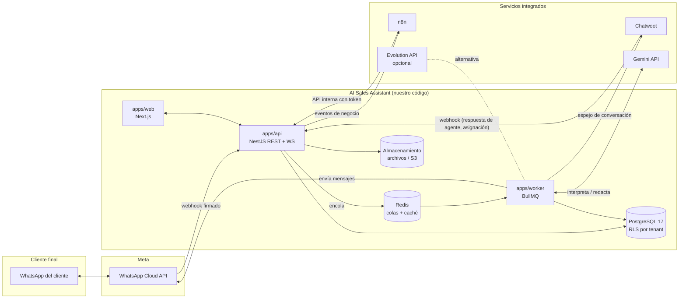
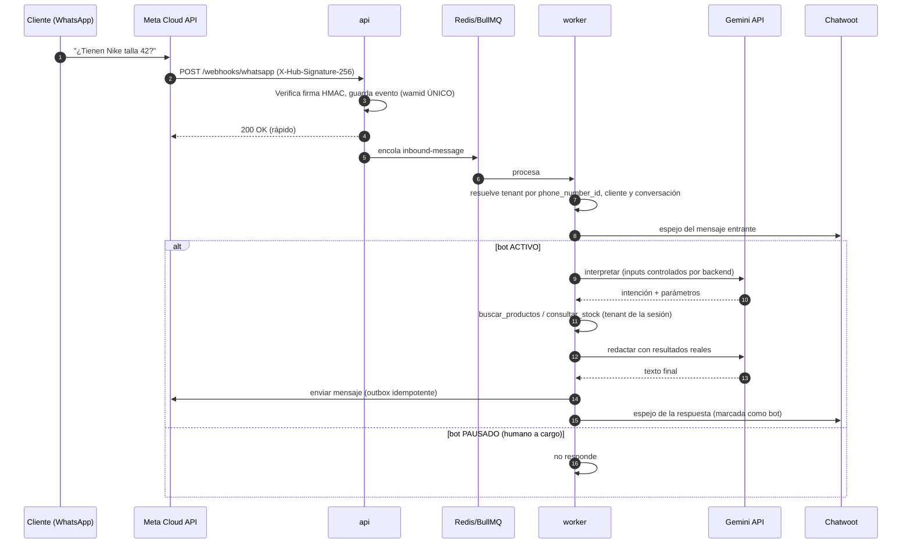
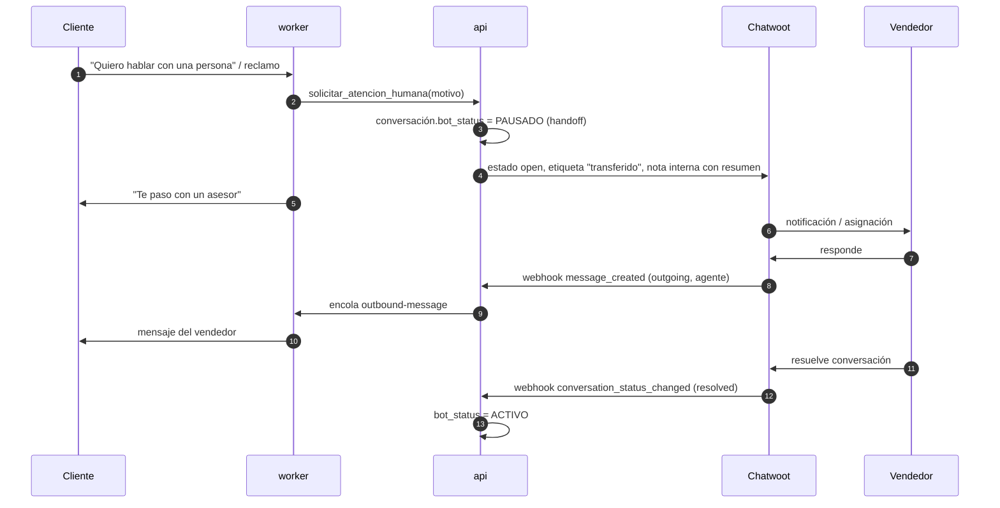

# Arquitectura técnica: AI Sales Assistant

> Estado: **propuesta definitiva v1** (FASE 1). Las decisiones marcadas como
> *pendiente* se cierran con el propietario del producto; ver `DECISIONS.md`.

## 1. Visión general

AI Sales Assistant es un SaaS multiempresa. Nuestro código (web, api, worker) es
la **única fuente de verdad comercial** (productos, precios, stock, pedidos,
clientes, estado de atención). Los cuatro proyectos de terceros se integran como
**servicios independientes**, por API/webhooks y con imágenes Docker oficiales,
sin modificar su código:

| Componente | Rol | Versión fijada | Licencia |
|---|---|---|---|
| WhatsApp Cloud API (Meta) | Canal oficial de mensajería | Graph API (versión a fijar en FASE 4) | Términos de Meta |
| Evolution API | Canal alternativo / desarrollo (opcional) | `evoapicloud/evolution-api:v2.3.7` | Apache 2.0 + condiciones |
| n8n | Automatizaciones internas | `n8nio/n8n:3.2.0` | Sustainable Use License |
| Chatwoot | Bandeja humana y supervisión | `chatwoot/chatwoot:v4.19.1` | MIT (salvo `enterprise/`) |
| Gemini API (Google) | Modelo de lenguaje del asistente (ADR 037), llamado por HTTPS desde el worker | `GEMINI_MODEL` (por defecto `gemini-3.8-flash`) | Servicio de pago por uso |

Versiones verificadas el 2026-11-10 contra las etiquetas de cada repositorio y los
manifiestos de Docker Hub. Detalle de licencias en `/LICENSES.md`.

## 2. Diagrama de componentes



**Regla de oro:** solo `apps/worker` envía mensajes a WhatsApp. Chatwoot nunca
habla directamente con Meta; así se evita que bot y agente respondan dos veces.

## 3. Aplicaciones propias

### apps/api (NestJS + TypeScript)
- Módulos: `auth`, `tenants`, `users`, `plans/usage`, `catalog` (productos,
  categorías, variantes, imágenes, historial), `inventory` (movimientos),
  `customers`, `orders`, `conversations`, `ai-tools`, `integrations`
  (whatsapp, chatwoot, dify, n8n), `reports`, `audit`, `health`.
- REST versionado (`/api/v1`), validación con DTO (class-validator), OpenAPI.
- WebSockets (Socket.IO, salas por tenant) para bandeja y dashboard en vivo.
- Autenticación: contraseñas con **Argon2id**; access token JWT corto (15 min) +
  refresh token rotatorio almacenado *hasheado* en BD, en cookie `HttpOnly`,
  `Secure`, `SameSite=Lax`; protección CSRF con *double submit token* en
  mutaciones basadas en cookie.
- Autorización: RBAC (`PLATFORM_ADMIN`, `TENANT_ADMIN`, `SUPERVISOR`, `SELLER`)
  con guards por permiso, **tenant_id tomado siempre del token**, nunca del
  cuerpo de la petición.

### apps/worker (Node + BullMQ)
Procesa colas con reintentos exponenciales y *dead letter queue*:
`inbound-message`, `outbound-message`, `chatwoot-sync`, `notifications`,
`stock-alerts`, `reports`. Es quien orquesta la conversación con la IA.

### apps/web (Next.js App Router + React + Tailwind)
Panel con sidebar, dashboard, tablas, gráficos, modo claro/oscuro, lector de
códigos de barras por cámara (API `BarcodeDetector` con *fallback* a librería
ZXing), responsive.

## 4. Multiempresa y aislamiento

Tres capas, ninguna depende del frontend:

1. **Aplicación:** cada consulta del repositorio filtra por `tenantId` del
   contexto de la petición (AsyncLocalStorage). Tests de aislamiento obligatorios.
2. **Base de datos (RLS):** todas las tablas de negocio llevan `tenant_id` y
   políticas `USING (tenant_id = current_setting('app.tenant_id')::uuid)`
   con `FORCE ROW LEVEL SECURITY`. La app se conecta con un rol **sin**
   `BYPASSRLS`; cada transacción ejecuta `SELECT set_config('app.tenant_id', $1, true)`.
   Las migraciones usan un rol propietario distinto.
3. **Servicios externos:** una *Account* de Chatwoot por empresa (Platform API);
   al modelo de IA solo se le envía la conversación de un cliente y los
   resultados de herramientas que el backend ejecuta con la empresa de esa
   conversación, de modo que las empresas nunca se mezclan.

## 5. Asistente IA y herramientas seguras (ADR 037)

La IA **no** accede a la base de datos. El flujo (`apps/api/src/ai`):

1. El worker guarda el mensaje (texto no confiable) y encola `ai-reply` con una
   breve espera (`AI_REPLY_DELAY_MS`) para juntar mensajes seguidos.
2. Antes de llamar al modelo comprueba: asistente activado, conversación sin
   atención humana, suscripción vigente, límite de conversaciones del plan y
   palabras de derivación (estas responden sin llamar al modelo).
3. Envía a Gemini las instrucciones (reglas + información del negocio), los
   últimos 20 mensajes y 4 herramientas. El backend las ejecuta con la empresa y
   el cliente de la conversación, nunca con lo que diga el modelo:
   `buscar_productos`, `ver_pedidos_del_cliente`, `crear_pedido`,
   `derivar_a_humano`. Argumentos validados con zod; máximo 5 rondas.
4. La respuesta sale por `OutboundService` (ventana de 24 h, suscripción,
   idempotencia `ai:<mensaje>`), igual que la de un agente.
5. Si Gemini falla, se reintenta (cuota o caída); al agotarse, la conversación
   pasa a una persona con aviso en el panel.

`crear_pedido` solo registra pedidos **PENDIENTES** con precios de la base de
datos y clave de idempotencia (mensaje + carrito); el stock se descuenta cuando
una persona confirma el pedido en el panel.

## 6. Diagramas de secuencia

### 6.1 Mensaje entrante con respuesta automática



### 6.2 Registro de pedido

```mermaid
sequenceDiagram
  autonumber
  participant C as Cliente
  participant W as worker
  participant D as Gemini API
  participant A as api (OrdersService)
  participant P as PostgreSQL
  participant N as n8n
  C->>W: "Quiero 2 pares talla 42"
  W->>D: interpretar
  W->>A: consultar_stock + consultar_precio
  W->>C: Resumen: 2 x Nike Air (T42) S/ 399.00 c/u = S/ 798.00 ¿Confirmas?
  C->>W: "Sí, confirmo"
  W->>A: crear_pedido(idempotency_key)
  A->>P: BEGIN; lock variantes; valida stock; inserta pedido + movimientos SALIDA_VENTA; COMMIT
  A-->>W: pedido #1024 creado (o el existente si la clave se repite)
  W->>C: Pedido #1024 registrado
  A->>N: evento order.created
  N->>N: notifica al vendedor / administrador
```

### 6.3 Transferencia a humano y reanudación



## 7. Fiabilidad e idempotencia

- Todo webhook entrante se registra en `inbound_events` con clave única del
  proveedor (`wamid`, id de Chatwoot). Duplicados → 200 sin reprocesar.
- Envíos salientes por *outbox* (`outbound_messages` con estado), reintentos con
  *backoff* y DLQ; errores de WhatsApp clasificados en reintentables / no.
- Operaciones comerciales (pedido, movimiento de stock) con claves de
  idempotencia y restricciones únicas en BD.
- Health checks: `/health/live`, `/health/ready` (PG, Redis, colas) y estado de
  integraciones externas en el panel.

## 8. Entornos

| | Desarrollo (Mac) | Producción |
|---|---|---|
| Compose | `docker-compose.yml` + Dify aparte | fichero de producción (FASE 8) |
| Puertos | solo `127.0.0.1` | solo reverse proxy 443 |
| TLS | no | obligatorio (Caddy/Nginx + Let's Encrypt) |
| BD | un servidor, una BD y un rol por servicio | instancias separadas o gestionadas, backups automáticos |
| Secretos | `.env` generado (600) | gestor de secretos / variables del orquestador |

**Requieren URL pública con HTTPS:** webhook de WhatsApp Cloud API (Meta no
acepta HTTP ni localhost) y la web/API para usuarios. **No se exponen:** n8n,
Dify consola, Evolution manager, Postgres, Redis. Chatwoot se publica solo para
agentes (subdominio propio, idealmente tras VPN o SSO). En desarrollo, el webhook
de Meta se prueba con un túnel HTTPS (p. ej. Cloudflare Tunnel).

## 9. Requisitos de hardware (desarrollo)

Stack completo (Chatwoot + n8n + Dify + apps) necesita **≥ 16 GB de RAM** y
asignar a Docker Desktop al menos 8–10 GB y ~40 GB de disco. Con 8 GB se trabaja
por perfiles (p. ej. sin Chatwoot o sin Dify).
